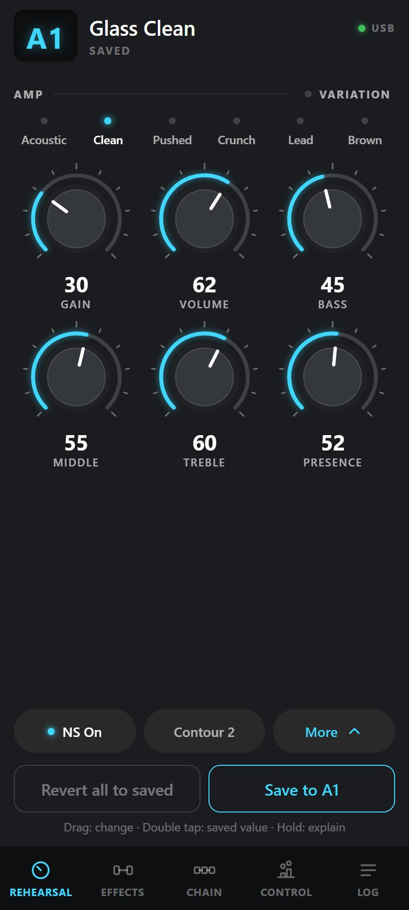

# Katana Studio

*for BOSS Katana Gen 3*

An Android editor for the BOSS Katana 100 Gen 3 over a plain USB cable: no Bluetooth adapter, no paywall.
Made for fine-tuning during rehearsal, phone in one hand, guitar on.

<p align="center"></p>

## Download

Get `katana-studio-X.Y.Z.apk` from the [Releases page](https://github.com/Jannes105/katana-studio/releases) and
install it on the phone (Android 10 or newer). Plug in the amp with a USB-C cable and the app opens by itself.

## Features

- **Rehearsal:** amp knobs, amp type, noise suppressor and contour on one screen, changes live, revert and undo
- **Saving:** onto A1–B4 with confirmation and read-back; unsaved changes survive a channel switch
- **Effects:** every type and knob of booster, mod, FX, delay, reverb, EQ, pedal FX, solo, send/return
- **Chain:** reorder the signal path by drag and drop
- **Control:** effect knob assigns, expression pedals, GA-FC footswitches, SYSTEM settings
- **Explanations:** long-press anything to learn what it does, with start values and sound tips
- **Files:** full backup, patch files, `.tsl` export for BOSS Tone Studio
- English and German

## Development

The UI is Svelte and TypeScript inside Capacitor; a small Kotlin plugin talks to the amp over the Android USB host
API. Protocol details are in [docs/protocol-notes.md](docs/protocol-notes.md), plan and roadmap (German) in
[docs/PLAN.md](docs/PLAN.md).

```
npm ci
npm run dev        # runs in the browser against a mock amp
npm run verify     # type check, lint, tests, build
npm run cap:sync   # then: cd android && ./gradlew assembleDebug
```

Needs Node 24; the Android build also needs JDK 21 and the Android command-line tools.

---

[MIT License](LICENSE). Unofficial hobby project, not affiliated with BOSS/Roland. BOSS and Katana are trademarks of Roland Corporation.
